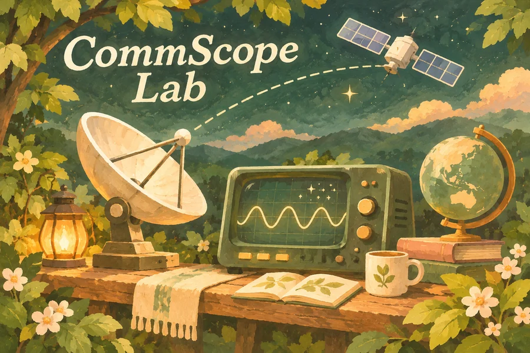
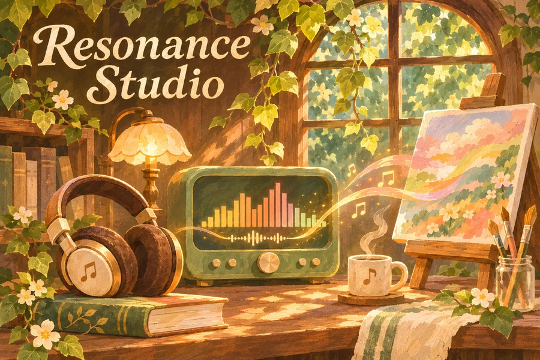

  

<h1 align="center">Hi, I'm Mecony 🌿</h1>

<b>Engineering, sound &amp; color.</b>

欢迎来到我的小小工作室。 这里收集通信实验、音乐可视化与配色工具。

## 🌱 Selected Projects · 精选作品

<table>
  <tr>
    <td width="33%" valign="top" align="center">
      
      <h3>CommScope Lab</h3>
      
<b>数字通信实验台</b>

      
让一段文字穿过噪声，观察星座图、接收错误与误码率。

      
BPSK / QPSK · AWGN · BER

      
<a href="https://github.com/Mecony/commscope-lab#运行">运行说明</a> · <a href="https://github.com/Mecony/commscope-lab">源码 Code</a>

    </td>
    <td width="33%" valign="top" align="center">
      
      <h3>Resonance Studio</h3>
      
<b>共振视觉工作台</b>

      
把音乐变成动态画面，调整视觉主题，导出图片与短片。

      
Web Audio · FFT · Canvas

      
<a href="https://mecony.github.io/resonance-studio/">在线体验 Demo</a> · <a href="https://github.com/Mecony/resonance-studio">源码 Code</a>

    </td>
    <td width="33%" valign="top" align="center">
      
      <h3>Palette Atelier</h3>
      
<b>森林配色画室</b>

      
从参考图收集主色，分析明暗，试着换一套喜欢的配色。

      
CIELAB · K-means · Web Worker

      
<a href="https://mecony.github.io/palette-atelier/">在线体验 Demo</a> · <a href="https://github.com/Mecony/palette-atelier">源码 Code</a>

    </td>
  </tr>
</table>

## 🧺 More Little Projects · 其他小作品

- **[Modulation Lab · 模拟调制实验台](https://github.com/Mecony/communication-modulation-simulator)** — 调节 AM、DSB-SC 和 FM 参数，对照观察消息信号、调制波形与频谱。
- **[Local Image Organizer · 本地图片整理器](https://github.com/Mecony/local-image-organizer)** — 预览批量命名与分类结果，再导出整理后的副本，方便收拾实验截图和绘画素材。

---

Signals · Music · Color

